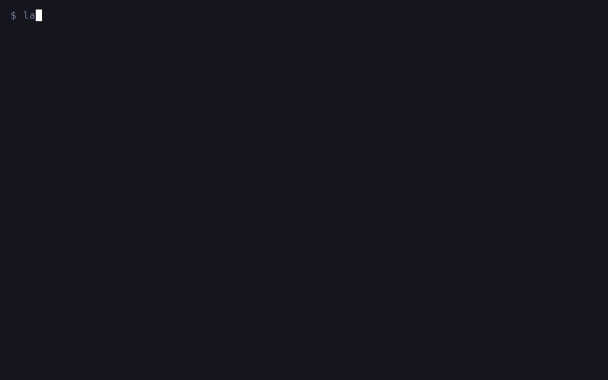

# LayerX Image Inspector

Inspect container image layers, find wasted bytes, and catch regressions in CI.
LayerX is a single binary for **Docker**, **Podman**, and **saved OCI or Docker
image archives**, with an interactive terminal UI and scriptable commands.

[](https://github.com/deveshctl/layerx/actions/workflows/ci.yml)
[](https://github.com/deveshctl/layerx/releases/latest)
[](https://pkg.go.dev/github.com/deveshctl/layerx)
[](https://scorecard.dev/viewer/?uri=github.com/deveshctl/layerx)




[Watch the demo (MP4)](assets/layerx-demo.mp4)

[Quick start](#quick-start) · [TUI guide](docs/tui.md) · [Compare](#compare-two-images) ·
[CI](#ci-mode) · [Install](docs/install.md)

## Quick start

**macOS** (13 Ventura or later):

```bash
brew install --cask deveshctl/tap/layerx
```

**Windows**:

```powershell
scoop bucket add layerx https://github.com/deveshctl/scoop-bucket
scoop install layerx
```

**Debian / Ubuntu** (amd64):

```bash
curl -LO https://github.com/deveshctl/layerx/releases/latest/download/layerx_linux_amd64.deb
sudo dpkg -i layerx_linux_amd64.deb
```

Then open an image:

```bash
layerx nginx:stable

# A saved archive works without a running engine.
layerx ./build/app.tar
```

Select a layer, press `Tab` to browse files, and press `Enter` to open one.
Press `w` to investigate waste and `?` for help.

## Why LayerX

| Question | Workflow |
|---|---|
| What did this Dockerfile step change? | Browse layers and highlighted file changes. |
| Why is the image so large? | Open wasted files with `w`, then jump to the introducing layer. |
| What is inside this file? | Open it with `Enter`, search with `/`, or save it with `x`. |
| Did the next build get worse? | Run `layerx compare OLD NEW`. |
| Can this image ship? | Run `layerx ci` with efficiency and path rules. |

Live inspection uses your active Docker context or Podman connection. Saved
Docker-save, Podman-save and OCI-layout tar archives need no daemon or registry.
Linux, macOS and Windows releases include amd64 and arm64 binaries.

## Install

[All installation options](docs/install.md): macOS Homebrew cask, Windows Scoop,
Debian/Ubuntu, RHEL/Fedora, direct downloads, container images and Go builds.
If you used the older Homebrew formula, follow the
[migration note](docs/install.md#homebrew-macos).

## Usage

```bash
# Inspect the platform that ships to production.
layerx --platform linux/arm64 nginx:stable

# Use Podman explicitly.
layerx --engine podman alpine:3

# Build through the engine and inspect the resulting image.
layerx build -t app:local .

# Re-analyze an unchanged image and refresh its cache.
layerx --no-cache app:local
```

An existing regular file is treated as an archive. Image references use the
selected engine. Inspection, CI, comparison and JSON export accept both.
`layerx build` builds through the engine, then inspects the resulting image.

### TUI keybindings

| Key | Action |
|---|---|
| `Tab` | Cycle Layers → Layer files → Cumulative (in split view). |
| `j` / `k` | Move down / up. |
| `/` | Filter file paths; search contents in the viewer. |
| `Enter` | Confirm a filter, open a file, or expand/collapse a directory. |
| `w` | Show wasted files; `Enter` jumps to the introducing layer. |
| `A` | Toggle Layer files + Cumulative split view. |
| `x` | Save the selected file to the current directory. |
| `?` | Open scrollable help. |
| `Esc` | Clear search/filter or close the current overlay/viewer. |
| `q` | Quit; use `Ctrl+C` while typing a search/filter. |

[Full TUI guide and keybindings](docs/tui.md) covers focus markers, size columns,
file origins, clipboard, long paths and small-terminal behavior.

### Split view (`A`)

**Layer files** highlights changes from the selected layer and keeps unchanged
files visible for context; `d` hides unchanged entries. **Cumulative** retains
diff markers from earlier layers, including historical removal markers.
Both panes follow the same selected layer. `Tab` cycles their focus.

The active panel title starts with `▸`. Short terminals show the active tree
in `compact` mode; growing the terminal restores both halves.
[Split-view walkthrough](docs/split-view.md).

## Container engines

LayerX follows the active Docker context or Podman connection. Override with
`--engine docker`, `--engine podman`, or engine environment variables.
[Engine setup and resolution order](docs/engines.md) includes local sockets,
remote connections and archive mode.

### Multi-platform images (`--platform`)

Use `--platform OS/ARCH[/VARIANT]` to select a live image variant. With a saved
archive, the option checks that the recorded platform matches your request.
[Platform examples](docs/engines.md#multi-platform-images---platform).

## CI mode

```bash
# Fail if efficiency is below 95%.
layerx ci --lowest-efficiency 0.95 app:local

# Generate a starter configuration for your stack.
layerx init --flavour python
layerx ci app:local
```

Configure efficiency thresholds and path rules in `.layerx.yaml`. Path rules
can block build caches or `.git` files even if a later layer deletes them.
Available starters: `node`, `python`, `java`, `go` and `generic`.

| Exit code | Meaning |
|---|---|
| `0` | Checks passed; comparison found no regression. |
| `1` | A CI rule failed or comparison detected a regression. |
| `2` | Operational error, such as a missing archive or unreachable engine. |

Run the command directly in your CI step to preserve its exit status.
[GitHub Actions and GitLab recipes](docs/ci-integration.md) ·
[Configuration reference](docs/configuration.md).

## Compare two images

```bash
layerx compare app:previous app:current
layerx compare ./build/previous.tar ./build/current.tar
layerx compare --mode full app:previous app:current
```

The report includes size, efficiency, layer, file and waste deltas. Compact
mode shows the largest entries; `--top N` changes the count, `--mode full`
includes all entries, and `--mode summary` keeps the header, any warnings and
the verdict.

Successful comparisons end with `verdict: ok`, `verdict: regression` with
reasons, or `verdict: noop` for identical inputs. Exit codes are `0`, `1` and
`2` as above. Progress goes to stderr; the report goes to stdout.

## JSON export

```bash
layerx --json analysis.json app:local
jq '.efficiency.score' analysis.json
jq '.efficiency.wastedFiles[:5]' analysis.json
```

JSON export skips the TUI. It can also accompany CI checks or a build:
`layerx ci --json analysis.json app:local` or
`layerx build --json analysis.json -t app:local .`.
[Schema and scripting recipes](docs/json-export.md).

## Theming

```bash
layerx --theme dracula nginx:stable
```

Eight built-in themes cover panels, diff colors, search and syntax highlighting.
`tokyo-night` is the default. Set `theme:` and optional
`transparent_background: true` in `.layerx.yaml` for repeat use.
[Theme reference](docs/theming.md).

## Caching & environment

Repeat inspections reuse analysis by image digest. `--no-cache` re-analyzes
and refreshes the cache.

```bash
layerx cache list
layerx cache prune --older-than 7d --dry-run
layerx cache prune --older-than 7d
```

| Variable | Purpose |
|---|---|
| `CI=true` | Run CI checks instead of the TUI for `layerx IMAGE`. |
| `LAYERX_CACHE_DIR` | Override the cache location. |
| `LAYERX_CACHE_TTL_DAYS` | Maximum age; default `30`, `0` disables. |
| `LAYERX_CACHE_MAX_BYTES` | Size limit; default 1 GiB, `0` disables. |

Bare `layerx cache prune` previews removals. `--all` removes every entry;
add `--dry-run` to preview it. Run `layerx cache prune --help` for details.

## Verifying releases

Releases include signed checksums, an SPDX SBOM per archive and SLSA
provenance. Follow the [verification recipe](docs/verifying-releases.md)
before deploying downloaded binaries in a trusted workflow.

## FAQ

[Questions and troubleshooting](docs/troubleshooting.md) covers daemon-free
use, Windows, engine errors, missing archives and choosing a native binary
or container image. [Switching from Dive](docs/migrating-from-dive.md).

## Troubleshooting

Start with `layerx --version`, check that the image/archive exists, and verify
your active engine connection. [Troubleshooting guide](docs/troubleshooting.md#troubleshooting).

## Contributing

See [CONTRIBUTING.md](CONTRIBUTING.md) for build, test and contribution rules.
Report security issues through [SECURITY.md](SECURITY.md).

## License

MIT — see [LICENSE](LICENSE).
